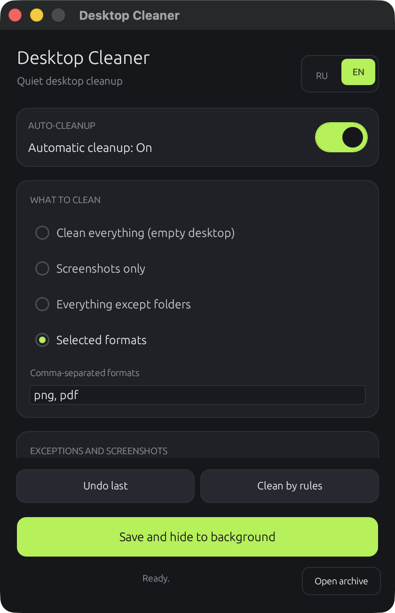
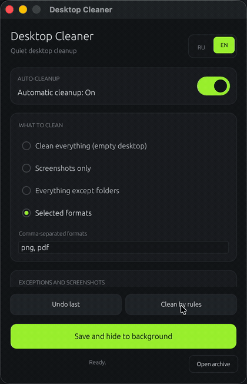

<h1 align="center">Desktop Cleaner</h1>

<p align="center">
  Lightweight, native macOS menu bar utility written in Rust that keeps your Desktop clean automatically without draining RAM or battery.
</p>

| Interface | Live Demo |
| :---: | :---: |
|  |  |

## Why Desktop Cleaner?

Most file organizers are heavy Electron apps that sit in your Dock and eat hundreds of megabytes of memory. Desktop Cleaner is built with native Rust (`egui` + `FSEvents`):

- **Zero idle overhead:** Once you save your rules, the settings window closes completely and unloads from memory. Only a tiny background watcher (~5 MB RAM) remains active via macOS `FSEvents`.
- **Smart rule priority:** Exceptions always win. Choose whether to clear everything, keep only folders, remove only screenshots (with full macOS Unicode NFD support), or target specific file extensions.
- **Flexible scheduling:** Clean up immediately (3-second debounce after new files appear), every N minutes, or once a day at a set time.
- **Safe archiving & one-click Undo:** Files are moved into organized date or category folders (`Images`, `Documents`, `Archives`, `Other`) instead of being deleted. Made a mistake? Restore the last batch with one click—existing files are never overwritten.
- **Auto-expiring quarantine:** Optionally move archived files older than 3, 5, 7, or 30 days to the macOS Trash automatically.
- **Finder grid alignment:** Automatically triggers Finder's desktop clean-up after moving files so your remaining icons don't leave awkward gaps.

## Installation

1. Go to the [Releases](../../releases) page and download `DesktopCleaner-macOS-AppleSilicon.zip`.
2. Unzip the archive and move **Desktop Cleaner.app** to your `/Applications` folder.
3. Launch the app. On first run, macOS will ask for permission to access your Desktop folder—click **Allow**.

*(Note: Since the app is self-signed, if macOS says the developer cannot be verified, right-click the app in Applications and select **Open**, or run `xattr -cr "/Applications/Desktop Cleaner.app"` in Terminal).*

## Building from Source

Requires Rust toolchain (`cargo`) on macOS:

```bash
git clone https://github.com/mrpixoff/desktop-cleaner.git
cd desktop-cleaner
./build_app.sh
```

This compiles the release binary, generates the application bundle with LSUIElement enabled (menu bar only, no Dock icon), and installs it to /Applications/Desktop Cleaner.app.

## Data & Configuration

All settings and undo history are stored locally in standard macOS application support paths:

- Configuration: `~/Library/Application Support/DesktopCleaner/config.json`
- Move history (Undo): `~/Library/Application Support/DesktopCleaner/journal.json`

## License

MIT
