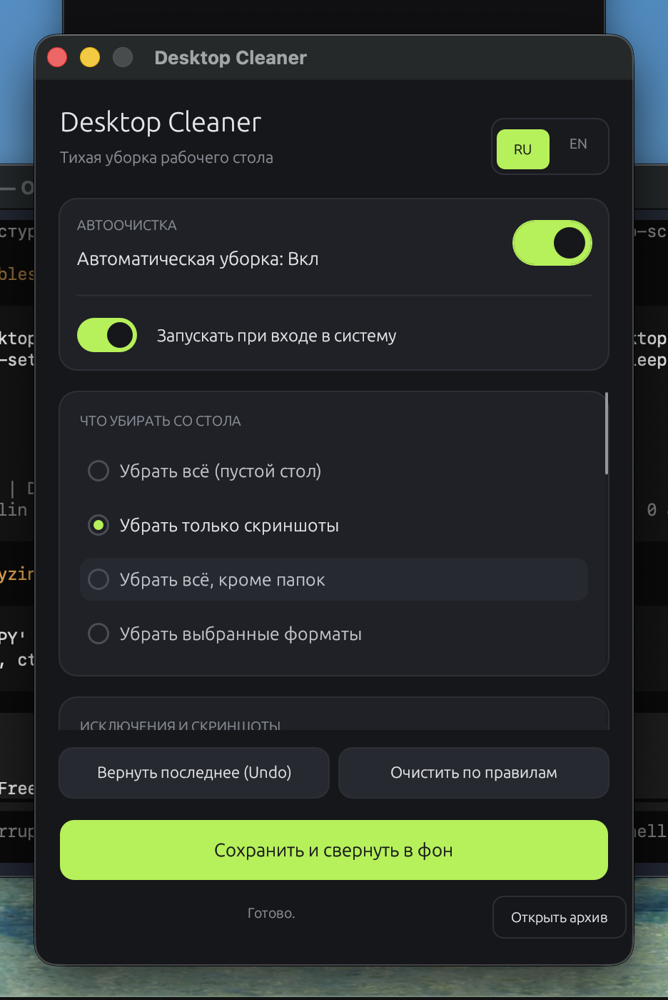

<p align="center">
  
</p>

<h1 align="center">Desktop Cleaner</h1>

<p align="center">
  Lightweight, native macOS menu bar utility written in Rust that keeps your Desktop clean automatically without draining RAM or battery.
</p>

<p align="center">
  
  &nbsp;&nbsp;
  
</p>

## Why Desktop Cleaner?

Most file organizers are heavy Electron apps that sit in your Dock and eat memory. Desktop Cleaner is a native Rust app (`egui` + `FSEvents`) built to stay small, predictable, and out of the way.

- **Zero idle overhead:** Once you save your rules, the settings window closes and unloads from memory. Only a tiny background watcher (~5 MB RAM) remains active via macOS `FSEvents`.
- **Native Launch at Login:** Enable or disable autostart directly from Settings or the tray menu. The toggle is backed by a native macOS LaunchAgent and stays in sync with the real system state, including changes made in macOS System Settings.
- **Smart rule priority:** Exceptions always win. Choose whether to clear everything, keep only folders, remove only screenshots (with full macOS Unicode NFD support), or target specific file extensions.
- **Flexible scheduling:** Clean up immediately (with a short debounce after new files appear), every N minutes, or once a day at a set time.
- **Reliable daily cleanup:** Daily schedules catch up after sleep or a late app launch, and wake-from-sleep is detected so cleanup runs when your Mac becomes active again.
- **Safe archiving & one-click Undo:** Files are moved into organized date or category folders (`Images`, `Documents`, `Archives`, `Other`) instead of being deleted. Restore the last batch with one click—existing files are never overwritten.
- **Auto-expiring quarantine:** Optionally move archived files older than 3, 5, 7, or 30 days to the macOS Trash automatically.
- **Archive protection:** The archive folder cannot be the Desktop or be moved into itself, preventing recursive archive loops.
- **Stability hardening:** Config and journal writes are atomic, incomplete browser downloads are ignored, and cross-device moves are verified before removing the source.
- **Finder grid alignment:** After moving files, Desktop Cleaner asks Finder to clean up Desktop icons so no awkward gaps remain.
- **English and Russian UI:** The interface switches between English and Russian and detects the system language on first launch.

## Installation

1. Go to the [Releases](../../releases) page and download `DesktopCleaner-macOS-AppleSilicon.dmg`.
2. Open the disk image and drag **Desktop Cleaner.app** into your `/Applications` folder.
3. Launch the app. On first run, macOS will ask for permission to access your Desktop folder—click **Allow**.
4. Optionally enable **Launch at Login** in Settings or from the tray menu.

> Since the app is self-signed, if macOS says the developer cannot be verified, right-click the app in Applications and select **Open**, or run `xattr -cr "/Applications/Desktop Cleaner.app"` in Terminal.

## Building from Source

Requires the Rust toolchain (`cargo`) on macOS:

```bash
git clone https://github.com/mrpixoff/desktop-cleaner.git
cd desktop-cleaner
./build_app.sh
```

This compiles the release binary, generates the application bundle with `LSUIElement` enabled (menu bar only, no Dock icon), and installs it to `/Applications/Desktop Cleaner.app`.

## Data & Configuration

All settings and undo history are stored locally in standard macOS application support paths:

- Configuration: `~/Library/Application Support/DesktopCleaner/config.json`
- Move history (Undo): `~/Library/Application Support/DesktopCleaner/journal.json`
- LaunchAgent: `~/Library/LaunchAgents/com.local.desktopcleaner.plist`

## License

MIT

---

## Почему Desktop Cleaner?

Большинство «очистителей рабочего стола» — тяжёлые Electron-приложения, которые висят в Dock и съедают сотни мегабайт памяти. Desktop Cleaner — нативное Rust-приложение (`egui` + `FSEvents`), которое остаётся лёгким и незаметным.

- **Нулевые накладные расходы в фоне:** после сохранения настроек окно закрывается и выгружается из памяти. В фоне остаётся только маленький наблюдатель (~5 МБ ОЗУ) на macOS `FSEvents`.
- **Нативный автозапуск при входе в систему:** включайте и выключайте автозапуск прямо в настройках или из меню трея. Переключатель работает через нативный LaunchAgent macOS и синхронизируется с реальным состоянием системы, включая изменения в Системных настройках macOS.
- **Умные приоритеты правил:** исключения всегда важнее. Можно убирать всё, оставлять только папки, переносить только скриншоты (с полной поддержкой Unicode NFD в macOS) или выбирать конкретные расширения файлов.
- **Гибкое расписание:** уборка сразу после появления файлов (с коротким debounce), каждые N минут или ежедневно в заданное время.
- **Надёжная ежедневная уборка:** ежедневное расписание догоняется после сна или позднего запуска приложения, а после пробуждения Mac очистка запускается, когда система снова активна.
- **Безопасный архив и Undo в один клик:** файлы переносятся в архив по дате или категориям (`Images`, `Documents`, `Archives`, `Other`), а не удаляются. Последнюю пачку можно вернуть одним кликом — существующие файлы никогда не перезаписываются.
- **Автокарантин по сроку:** при желании файлы старше 3, 5, 7 или 30 дней можно автоматически отправлять в Корзину macOS.
- **Защита архива:** папка архива не может совпадать с Рабочим столом или перемещаться сама в себя — это исключает зацикливание.
- **Повышенная стабильность:** конфиг и журнал записываются атомарно, недокачанные файлы браузеров игнорируются, а перенос между дисками проверяется перед удалением исходника.
- **Выравнивание иконок Finder:** после переноса файлов Desktop Cleaner просит Finder выровнять иконки, чтобы на Рабочем столе не оставалось пустых «дыр».
- **Интерфейс на английском и русском:** язык переключается в настройках, а при первом запуске определяется по системе.

## Установка

1. Откройте страницу [Releases](../../releases) и скачайте `DesktopCleaner-macOS-AppleSilicon.dmg`.
2. Откройте образ диска и перетащите **Desktop Cleaner.app** в папку `/Applications`.
3. Запустите приложение. При первом запуске macOS попросит доступ к папке Рабочего стола — нажмите **Allow**.
4. При желании включите **«Запускать при входе в систему»** в настройках или через меню трея.

> Так как приложение самоподписанное, macOS может сообщить, что разработчик не проверен. Нажмите правой кнопкой на приложение в Applications и выберите **Open**, либо выполните в Terminal: `xattr -cr "/Applications/Desktop Cleaner.app"`.

## Сборка из исходников

Нужен Rust toolchain (`cargo`) на macOS:

```bash
git clone https://github.com/mrpixoff/desktop-cleaner.git
cd desktop-cleaner
./build_app.sh
```

Скрипт собирает release-бинарник, создаёт `.app`-бандл с `LSUIElement` (только меню-бар, без иконки в Dock) и устанавливает его в `/Applications/Desktop Cleaner.app`.

## Данные и конфигурация

Настройки и история Undo хранятся локально в стандартных папках macOS:

- Конфигурация: `~/Library/Application Support/DesktopCleaner/config.json`
- История перемещений (Undo): `~/Library/Application Support/DesktopCleaner/journal.json`
- LaunchAgent: `~/Library/LaunchAgents/com.local.desktopcleaner.plist`

## Лицензия

MIT
